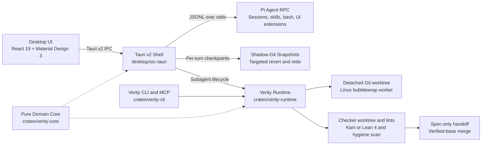

# Verity architecture and reference

Verity pairs a pure Rust verification core, a Git and sandbox runtime, a CLI and local MCP server, and a Tauri v2 desktop app. This document covers system structure, workspace layout, the write-task lifecycle, CLI and MCP usage, checker configuration, and project self-verification.

## System architecture



### Feature highlights

| Area | Capabilities |
| :--- | :--- |
| Multi-project desktop | Stores workspaces in `~/.verity/projects.json` (or `$VERITY_HOME/projects.json`), opens repositories through the native folder picker (`tauri-plugin-dialog`), and isolates Pi sessions and archive state (`session-meta.json`) per project. |
| Pi RPC and providers | Supports slash commands, skills, prompt templates, `!` and `!!` bash execution, session settings and stats, and extension dialogs, toasts, and widgets. Provider settings live in `providers.json`, which Verity writes with owner-only permissions on Unix. |
| Turn revert and checkpoints | Captures shadow Git snapshots in `~/.verity/snapshots/` for conditional file restore on turn revert and file-only redo. |
| Subagents and handoffs | Runs read-only subagents via Pi read tools, isolates write subagents in detached Git worktrees, enforces scope and comment-aware hygiene lints, runs Kani or Lean 4 in a fresh checkout, and integrates approved candidates with `git merge-tree`. |

## Workspace layout

| Path | Contents |
| :--- | :--- |
| [`crates/verity-core`](crates/verity-core) | Zero-IO Rust domain types, Pi session transitions and wire parsing, provider URL validation, write-scope rules with a co-located Verus proof in [`crates/verity-core/src/scope/proof.rs`](crates/verity-core/src/scope/proof.rs), Kani verdict classification, and JSON parsing. |
| [`crates/verity-runtime`](crates/verity-runtime) | Native `git worktree` and `git merge-tree` operations, rootless Linux `bubblewrap` and macOS `sandbox-exec` sandboxing, `O_NOFOLLOW` workspace path jail (`jail.rs`), comment-aware Kani and Lean 4 hygiene scanners, Pi JSONL RPC client, write-subagent orchestrator, and spec-only handoff extractor. |
| [`crates/verity-cli`](crates/verity-cli) | Headless `verity` CLI (`run-readonly`, `spawn`, `review`, `merge`, `log`) and local STDIO JSON-RPC 2.0 MCP server (`verity mcp`). |
| [`desktop/`](desktop) | Tauri v2 Rust backend (`desktop/src-tauri/`) and Material Design 3 React 19 frontend (`desktop/ui/`). |
| [`formal/`](formal) | Kani proof harnesses for `verity-core` (`formal/src/`) and TLA+ models plus trace replay scripts for approval and desktop checkpoint restore (`formal/tla/`). |

## Write task lifecycle and merge approval

A write task runs through six stages from invocation to branch integration:

1. You supply a repository path, `task_id`, `base_ref`, non-empty `write_scope`, optional `forbidden` paths, verifier (`kani` or `lean`), and goal.
2. Verity resolves `base_ref` to `base_commit`, creates a locked detached worktree at `<repo>/.verity/worktrees/<task_id>`, and starts Pi inside a Linux `bubblewrap` sandbox.
3. After Pi returns, Verity commits the worktree changes to `candidate_commit` and extracts the committed diff between `base_commit` and `candidate_commit`.
4. Verity checks the committed diff paths against `write_scope` and `forbidden` using `verity_core::check_scope`.
5. For a settled turn with live verification enabled, Verity runs Kani or Lean 4 offline in a fresh checkout at `<repo>/.verity/checker-worktrees/<task_id>`. Otherwise it records an inconclusive verdict. Verity scans the changed files, extracts a review summary, computes `spec_digest`, and saves the handoff under `<repo>/.verity/handoffs/`. It attempts to log the result and remove its temporary worktrees when the operation ends.
6. On approval, Verity verifies the submitted `spec_digest`, confirms a `pass` verdict and clean hygiene report, checks the target branch state, merges via `git merge-tree --write-tree` and `git commit-tree`, and updates or fast-forwards the target branch.

### Worker sandbox and checked Git diff scope

Verity separates process isolation during editing from scope enforcement after the edit finishes:

- **Worker sandbox during execution.** On Linux, the write worker runs under `bubblewrap` (`bwrap`) with a read-only root filesystem, dropped capabilities (`--cap-drop ALL`), isolated user, PID, and IPC namespaces, `--disable-userns`, `--die-with-parent`, a writable mount on `.verity/worktrees/<task_id>`, read-only mounts on `$GIT_COMMON_DIR` and the worktree `.git` entry, `HOME` set to the worktree, and `TMPDIR=/tmp`. Network access stays enabled so Pi can call the model provider, and the controller forwards `ANTHROPIC_API_KEY`, `OPENAI_API_KEY`, `GEMINI_API_KEY`, `GOOGLE_API_KEY`, and `OPENROUTER_API_KEY` when set in the controller environment. While running, Pi can write anywhere inside its detached worktree except Git metadata. The `WorkspaceJail` helper in [`crates/verity-runtime/src/jail.rs`](crates/verity-runtime/src/jail.rs) provides `O_NOFOLLOW` path-jailed file operations for library callers, separate from the Pi CLI subprocess.
- **Checked Git diff scope after completion.** Once Pi finishes, Verity commits the worktree and runs `git diff --no-ext-diff --no-renames --raw --no-abbrev --ignore-submodules=none` between `base_commit` and `candidate_commit`. Verity rejects any non-regular file entry such as a symlink or submodule, then checks the resulting case-sensitive Git tree paths with `verity_core::check_scope`. Empty diffs are rejected, `forbidden` prefixes override `write_scope`, and any path outside `write_scope` fails the task before handoff creation.
- **Offline checker sandbox.** External Kani and Lean 4 checkers run in a separate fresh worktree under an offline sandbox (`--unshare-net` on Linux) with read-only mounts for the configured checker binary, config, and Lean export file.

### Read-only fallback

Read-only subagents (`verity run-readonly`, `verity_run_readonly`, and desktop `run_readonly_subagent`) use OS sandboxing when available and fall back to Pi tool restrictions elsewhere:

- On Linux when `bubblewrap` with user and PID namespaces is available (`pi_sandbox_available()`), Verity mounts the repository read-only (`--ro-bind`), sets `HOME=/tmp`, enables network access for provider calls, and passes `--no-extensions --no-prompt-templates --tools read,grep,find,ls`.
- On macOS, Windows, or Linux hosts without `bubblewrap`, Verity runs Pi directly without an OS filesystem sandbox and relies on `--no-extensions --no-prompt-templates --tools read,grep,find,ls` to restrict the worker to read-only tools.

Write subagents have no fallback. Non-Linux hosts and Linux hosts without `bubblewrap` reject write tasks before starting Pi.

### Branch integration and expected-OID updates

When approving a handoff for `target_ref`, Verity first checks whether `candidate_commit` is already an ancestor of `target_ref`. If it is, approval succeeds as `already_merged: true` without creating a new merge commit. Otherwise `target_ref` must still point to `base_commit`; if the branch moved elsewhere, Verity rejects the merge and you must rerun the task against the new base.

After `git merge-tree --write-tree` and `git commit-tree` produce the merge commit, Verity inspects `git for-each-ref --format=%(worktreepath)` on `refs/heads/<target_ref>` and branches on whether a worktree has it checked out:

- **Branch with no checkout.** Verity updates the branch atomically with an expected-OID compare-and-swap via `git update-ref --no-deref -- <branch> <merged> <expected>`.
- **Checked-out branch.** Verity assumes the active checkout stays stable on that branch. It checks that `HEAD` symbolically points to `<branch>` at `<expected>`, requires `git status --porcelain --untracked-files=no` to be empty, and runs `git merge --ff-only --no-autostash --no-overwrite-ignore`. Serialize approval with any Git command that switches branches or modifies tracked files in the active checkout.

### Desktop turn checkpoints, conditional restore, and file-only redo

The desktop app stores per-project state under `~/.verity/` (or `$VERITY_HOME` if set), including `projects.json`, `session-meta.json`, `providers.json`, and shadow Git repositories under `snapshots/<project-hash>/`:

- **Conditional file restore on turn revert.** Reverting a chat turn rewinds the Pi session to that turn (forking on the resolved entry ID, or falling back to a new session at turn 0 when no fork entries exist). When code revert is requested, Verity checks `checkpoints.json` for a snapshot matching the active session lineage and target turn. If a matching checkpoint exists, Verity saves a pre-revert `redo_tree_oid`, runs preflight collision checks against symlinks, `.git`, ignored files, and non-empty directories, and updates only the files that differ from the checkpoint tree (preserving mtimes on untouched files). If no matching checkpoint exists, only the chat turn rewinds.
- **File-only redo.** Redo restores only the files from the most recent code revert recorded in `last_redo`. It does not restore or advance the chat turn. Redo requires the active Pi session to match the session that performed the revert (when recorded), checks that no affected path or its ancestors or descendants changed after the revert, and clears `last_redo` only after the file restore succeeds.

## CLI and MCP usage

Build the `verity` CLI binary from the repository root:

```sh
cargo build --release -p verity-cli
```

Cargo writes `./target/release/verity` without adding it to your `PATH`. Run `./target/release/verity` directly, or install it onto your `PATH` with `cargo install --path crates/verity-cli`.

The desktop app locates `verity` beside its own executable or on `PATH`. Set `VERITY_MCP_BIN` to an absolute executable path to override discovery.

### CLI subcommands

- `verity run-readonly <repo> <goal> [pi-bin]` runs a read-only Pi subagent and prints a JSON summary.
- `verity spawn <repo> <task-id> <base-ref> <kani|lean> <write-scope-csv> <goal> [pi-bin]` runs a write subagent, checks scope and verification, and writes `.verity/handoffs/<task-id>.json`.
- `verity review <repo> <task-id>` prints the saved handoff JSON for a task.
- `verity merge <repo> <task-id> <target-ref> <approved-digest>` merges an approved candidate into `target-ref` if its `spec_digest` matches and all gates pass.
- `verity log <repo>` prints events from `.verity/run-log.jsonl`.
- `verity mcp` starts a local STDIO JSON-RPC 2.0 MCP server.

### CLI example workflow

```sh
# 1. Inspect a repository without modifying files
./target/release/verity run-readonly /path/to/repo "Summarize how request validation works"

# 2. Run a scoped write task checked with Kani
./target/release/verity spawn /path/to/repo fix-overflow main kani "src/math.rs" \
  "Fix saturating addition in add_u32 and add a Kani proof harness"

# 3. Inspect the handoff and copy its spec_digest
./target/release/verity review /path/to/repo fix-overflow

# 4. Merge the candidate commit into main using the approved spec_digest
SPEC_DIGEST="paste-64-char-hex-digest-here"
./target/release/verity merge /path/to/repo fix-overflow main "$SPEC_DIGEST"
```

### MCP tools and example

`verity mcp` reads newline-delimited JSON-RPC 2.0 requests on stdin and exposes three tools:

- `verity_run_readonly` (`repo`, `goal`)
- `verity_spawn_write` (`repo`, `task_id`, `write_scope`, `verifier`, `goal`, plus optional `base_ref` defaulting to `"HEAD"` and optional `forbidden`)
- `verity_merge_approved` (`repo`, `task_id`, `target_ref`, `approved_digest`)

MCP requests always use the controller's Pi command and reject `pi_bin` or `pi_args` overrides. Example `tools/call` request to spawn a Kani write task:

```json
{"jsonrpc":"2.0","id":1,"method":"tools/call","params":{"name":"verity_spawn_write","arguments":{"repo":"/path/to/repo","task_id":"fix-overflow","base_ref":"main","write_scope":["src/math.rs"],"verifier":"kani","goal":"Fix saturating addition in add_u32 and add a Kani proof harness"}}}
```

## Configuring Kani and Lean 4 checkers

App checkers verify candidate write tasks inside `.verity/checker-worktrees/<task_id>`. Keep all checker binaries, configs, and Lean export files outside the candidate worktree, and pass absolute paths:

- **Kani (`0.68.0`).** Set `VERITY_KANI` to the absolute path of a trusted `kani` or `cargo-kani` executable with a prepared toolchain. By default, Verity discovers `#[kani::proof]` and `#[cfg_attr(kani, kani::proof)]` harnesses in changed `.rs` files and runs standalone `kani` (`--crate-name verity_candidate`). For proofs under `src/` in a package with a `Cargo.toml`, set `VERITY_CARGO_KANI` to an absolute `cargo-kani` or `cargo` binary (or point `VERITY_KANI` to `cargo-kani`) so Verity runs `cargo kani`. Verity requires at least one successful assertion check rather than implicit safety or `cover!` checks alone. Because Kani checks bounded properties, inspect the extracted spec, unwind bounds, and any `kani::assume` lines in the handoff before approving.
- **Lean 4.** Set `VERITY_LEAN_COMPARATOR` to the absolute path of a trusted `lake` binary and `VERITY_LEAN_COMPARATOR_CONFIG` to the absolute path of your comparator JSON configuration. Place `challenge.export` at the repository root (or pass `lean_challenge_export` through `WriteTaskOptions` in Rust) so Verity can run `lake comparator --config=... --challenge-from-export=... --paranoid`.

### Layer 1 hygiene scanners

Before building a handoff, Verity runs comment-aware and string-aware scanners (`hygiene_lint_rust` and `hygiene_lint_lean`) over every changed file to flag recognized bypass patterns:

- **Rust.** `kani::stub`, `kani::should_panic`, `no-unwinding-assertions`, and `kani::assume` (or imported `assume(...)`) without a `// verity:trusted-assume` comment on that line.
- **Lean 4.** `sorry`, custom `axiom `, `partial def`, `unsafe `, `@[implemented_by`, `@[extern`, `@[csimp`, and `native_decide`.

These scanners flag known escape hatches rather than guaranteeing detection of every possible workaround.

## Project verification and CI

Project proof CI verifies Verity's own codebase independently of the app checkers that run on user write tasks. Verity's verification suite has three layers:

1. **Formal verification.** Kani `0.68.0` harnesses in [`formal/src/`](formal/src) check bounded properties for scope policy, paths, Pi session transitions, verifier verdicts, provider URLs, and JSON helpers. A Verus proof in [`crates/verity-core/src/scope/proof.rs`](crates/verity-core/src/scope/proof.rs) verifies the shared Rust scope decision across all supported input lengths. TLA+ models in [`formal/tla/approval/`](formal/tla/approval) and [`formal/tla/restore/`](formal/tla/restore) check approval and desktop restore state machines, and CI validates recorded production traces against them.
2. **Runtime and desktop backend tests.** Tests in [`crates/verity-runtime/tests/`](crates/verity-runtime/tests) and [`desktop/src-tauri/`](desktop/src-tauri) exercise real Git worktrees and `merge-tree`, Linux worker isolation, handoff digests, Kani and Lean export parsing, targeted snapshot restore and redo, and Pi JSONL commands.
3. **Frontend and Pi extension tests.** Tests in [`desktop/ui/src/verify/`](desktop/ui/src/verify) check the TypeScript event parser and store laws, render approval and merge views, and exercise the bundled Pi extension offline.

### Running project checks locally

Run the Rust workspace and Tauri backend tests, formatting checks, and Clippy lints from the repository root:

```sh
npm test
cargo test --manifest-path desktop/src-tauri/Cargo.toml
cargo fmt --all -- --check
cargo fmt --manifest-path desktop/src-tauri/Cargo.toml -- --check
cargo clippy --workspace --all-targets -- -D warnings
cargo clippy --manifest-path desktop/src-tauri/Cargo.toml --all-targets -- -D warnings
```

Run the frontend build, state tests, and offline Pi extension test (after `npm run setup`):

```sh
npm --prefix desktop/ui run build
node --test desktop/ui/src/verify/piStore.laws.mjs desktop/ui/src/verify/verificationViews.test.mjs
(cd desktop/ui && npm exec --yes --package=@earendil-works/pi-coding-agent@1.5.2 -- node --test src/verify/piExtension.test.mjs)
```

Run the Kani `0.68.0` proofs in `formal/`:

```sh
npm run formal
```

The workflows in [`.github/workflows/formal.yml`](.github/workflows/formal.yml), [`.github/workflows/desktop.yml`](.github/workflows/desktop.yml), and [`.github/workflows/tests.yml`](.github/workflows/tests.yml) also run the pinned Linux Verus proof on `crates/verity-core/src/lib.rs`, live Linux Kani and Lean comparator end-to-end tests, and TLC checks on the TLA+ models. To install TLC locally with Java available, run `bash formal/tla/install-tool.sh /tmp/tla2tools.jar`.

### Validate a local branch on GitHub

Repository workflows run on pull requests and on pushes to `main` and `ci/verify/**`. To test a local commit in CI without opening a pull request, push it to a temporary branch under `ci/verify/`, check the workflow results for that commit, and delete the temporary branch after it finishes.
