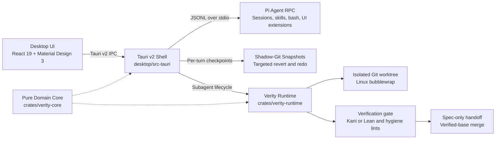

# Verity

A Rust controller and Tauri v2 Material Design 3 desktop app for running coding subagents under machine-checked contracts.

[](https://www.rust-lang.org/)
[](https://v2.tauri.app/)
[](https://m3.material.io/)
[](https://model-checking.github.io/kani/)
[](https://www.apache.org/licenses/LICENSE-2.0)

## Why Verity?

Coding agents break repositories when they edit the main checkout directly or skip verification. Verity separates read work from write work and enforces formal checks before any change reaches your branch.

- Read-only subagents use Pi's read tools and return text summaries.
- Write subagents run in locked Git worktrees under bubblewrap on Linux. Other platforms reject write tasks before starting Pi.
- The controller verifies a fresh checkout of the candidate commit. Approval requires a passing Kani or Lean verdict and the digest shown in its review bundle.
- The desktop app keeps Pi sessions per project and captures code checkpoints for chat turns. Code restore requires a matching checkpoint. Redo requires the same session and rejects later edits to affected paths.

## Architecture



## Feature highlights

| Area | Capabilities |
| :--- | :--- |
| Multi-project desktop | Stores workspaces in `~/.verity/projects.json`, opens repositories through the native folder picker (`tauri-plugin-dialog`), and isolates Pi sessions per project. |
| Pi RPC | Supports slash commands, skills, prompt templates, `!` and `!!` bash execution, a session settings and stats modal, and extension UI dialogs, toasts, and widgets. |
| Turn revert and checkpoints | Captures shadow Git snapshots for targeted chat and code revert and redo. |
| Formal verification and handoffs | Uses Kani or Lean to check write tasks and `git merge-tree` to integrate approved candidates. The repository's proof suite in `formal/` checks bounded Rust properties. |

## Quick start

### Prerequisites

Install these tools before building Verity:

- Rust (stable toolchain)
- Node.js 22 or newer
- Git 2.38 or newer (required for `git merge-tree --write-tree`)
- Tauri v2 OS libraries (on Ubuntu or Debian, install `libwebkit2gtk-4.1-dev libgtk-3-dev libayatana-appindicator3-dev librsvg2-dev`)
- Kani 0.68.0 (required only to run formal proofs)

### Setup and run

1. Install desktop and UI dependencies from the repository root:

```sh
npm run setup
```

2. Launch the native Tauri v2 desktop app:

```sh
npm run tauri:dev
```

3. Preview the Material Design 3 UI in a browser without Tauri:

```sh
npm run dev
```

4. Build a production desktop binary:

```sh
npm run tauri:build
```

### Write task requirements

Write tasks require Linux with bubblewrap and user namespaces enabled. Use a system-installed Pi and Node.js. Supply the model provider's API key in the controller environment. The worker uses a private home and can reach the network to call the provider.

The controller forwards API keys from `ANTHROPIC_API_KEY`, `OPENAI_API_KEY`, `GEMINI_API_KEY`, `GOOGLE_API_KEY`, and `OPENROUTER_API_KEY` when those variables are set.

The desktop app locates the `verity` CLI beside its executable or on `PATH`. Set `VERITY_MCP_BIN` to an absolute executable path to override discovery.

- For Kani, set `VERITY_KANI` to the absolute path of a trusted Kani 0.68.0 launcher with a prepared toolchain. The controller checks standalone Rust files by default. For a proof under `src/` in a Cargo package, set `VERITY_CARGO_KANI` to the absolute path of a trusted Cargo Kani launcher.
- For Lean, set `VERITY_LEAN_COMPARATOR` to the absolute path of a trusted `lake` launcher and `VERITY_LEAN_COMPARATOR_CONFIG` to its trusted comparator configuration. Keep these files and `challenge.export` outside the candidate checkout.

Review the proof statements and scope in the handoff before approving. The checker result applies to the candidate commit and the obligations it ran. If the target branch moves, rerun the task against the new base.

## Workspace layout

| Path | Contents |
| :--- | :--- |
| `crates/verity-core` | Zero-IO Rust domain types, Pi session transitions and wire types, provider URL validation, write-scope rules, Kani verdict classification, and JSON parsing. |
| `crates/verity-runtime` | Native `git worktree` and `git merge-tree` operations, rootless Linux `bubblewrap` and macOS `sandbox-exec` sandboxing, `O_NOFOLLOW` workspace path jail, comment-aware Kani and Lean 4 hygiene lints, Pi JSONL RPC client, write-subagent orchestrator, and spec-only handoff extractor. |
| `crates/verity-cli` | Headless `verity` CLI (`run-readonly`, `spawn`, `review`, `merge`, `log`) and local STDIO MCP server (`verity mcp`). |
| `formal/` | Kani 0.68.0 proof harnesses for core parsing, validation, approval, and Pi session activity. |
| `desktop/` | Tauri v2 Rust shell (`desktop/src-tauri/`) and Material Design 3 React 19 frontend (`desktop/ui/`). |

## Verification

Verity uses a three-layer verification architecture:

1. **Formal proofs (`formal/`)** check bounded inputs for core scope, paths, Pi session activity, verifier verdicts, provider URLs, and JSON helpers.
2. **Runtime and desktop tests** exercise real Git worktrees and merges, Linux worker isolation, handoff digests, checker reports, targeted Git restore, and Pi JSONL commands.
3. **Frontend tests** exercise the TypeScript event parser and reducer with example scenarios and generated traces. The rendering tests inspect approval and merge controls, and the offline Pi test loads the bundled extension.

### Running checks locally

Run the Kani proofs in `formal/` with Kani 0.68.0:

```sh
npm run formal
```

Run the full Rust workspace and Tauri backend test suites:

```sh
npm test
```

Run the Tauri backend test suite by itself:

```sh
cargo test --manifest-path desktop/src-tauri/Cargo.toml
```

Run the frontend state and rendering tests after `npm run setup`:

```sh
node --test desktop/ui/src/verify/piStore.laws.mjs desktop/ui/src/verify/verificationViews.test.mjs
```

### Validate a local branch on GitHub

The repository workflows run on pushes to `main` and `ci/verify/**` branches, and on pull requests. To validate a local commit without opening a pull request, push it to a temporary branch under `ci/verify/`. Check the workflow results for that commit, then delete the temporary branch after they pass.

## License

Licensed under [Apache-2.0](https://www.apache.org/licenses/LICENSE-2.0).
