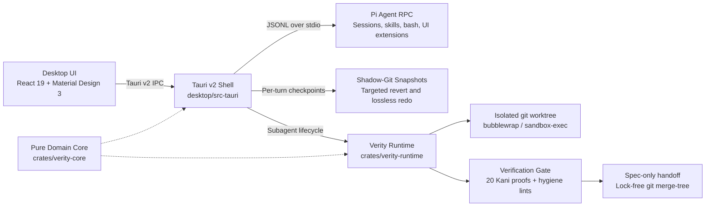

# Verity

A Rust controller and Tauri v2 Material Design 3 desktop app for running coding subagents under machine-checked contracts.

[](https://www.rust-lang.org/)
[](https://v2.tauri.app/)
[](https://m3.material.io/)
[](https://model-checking.github.io/kani/)
[](https://www.apache.org/licenses/LICENSE-2.0)

## Why Verity?

Coding agents break repositories when they edit the main checkout directly or skip verification. Verity separates read work from write work and enforces formal checks before any change reaches your branch.

- Read-only subagents run without worktrees and return text summaries.
- Write subagents run inside locked `git worktree` checkouts with OS sandboxing and an `O_NOFOLLOW` path jail.
- Every write task produces a stripped spec-only review bundle and passes Kani or Lean 4 verification before lock-free `git merge-tree` integration.
- The desktop app persists workspaces per project, speaks full Pi JSONL RPC, and snapshots repository state on every turn so you can revert chat and code together without losing redo history.

## Architecture



## Feature highlights

| Area | Capabilities |
| :--- | :--- |
| Multi-project desktop | Stores workspaces in `~/.verity/projects.json`, opens repositories through the native folder picker (`tauri-plugin-dialog`), and isolates Pi sessions per project. |
| Full Pi RPC parity | Supports slash commands, skills, prompt templates, `!` and `!!` bash execution, a session settings and stats modal, and extension UI dialogs, toasts, and widgets. |
| Turn revert and checkpoints | Captures shadow-git snapshots on each turn for targeted chat and code revert with lossless redo, plus one-click copy for individual messages or full chats. |
| Formal verification and handoffs | Runs 20 Kani `#[kani::proof]` drivers in `formal/` against `verity-core` and protocol contracts, enforces OS sandboxing (`bubblewrap` on Linux, `sandbox-exec` on macOS), and merges approved changes with `git merge-tree`. |

## Quick start

### Prerequisites

Install these tools before building Verity:

- Rust (stable toolchain)
- Node.js 22 or newer
- Git 2.38 or newer (required for `git merge-tree --write-tree`)
- Tauri v2 OS libraries (on Ubuntu or Debian, install `libwebkit2gtk-4.1-dev libgtk-3-dev libayatana-appindicator3-dev librsvg2-dev`)
- Kani 0.68.0 (required only to run formal proofs)

### Setup and run

1. Install desktop and UI dependencies from the repository root:

```sh
npm run setup
```

2. Launch the native Tauri v2 desktop app:

```sh
npm run tauri:dev
```

3. Preview the Material Design 3 UI in a browser without Tauri:

```sh
npm run dev
```

4. Build a production desktop binary:

```sh
npm run tauri:build
```

## Workspace layout

| Path | Contents |
| :--- | :--- |
| `crates/verity-core` | Zero-IO pure Rust domain types, task state machine, Pi session exclusivity laws, Pi wire types, provider URL validation, write-scope rules, Kani verdict classifier, and JSON parser. |
| `crates/verity-runtime` | Native `git worktree` and `git merge-tree` operations, rootless Linux `bubblewrap` and macOS `sandbox-exec` sandboxing, `O_NOFOLLOW` workspace path jail, comment-aware Kani and Lean 4 hygiene lints, Pi JSONL RPC client, write-subagent orchestrator, and spec-only handoff extractor. |
| `crates/verity-cli` | Headless `verity` CLI (`run-readonly`, `spawn`, `review`, `merge`, `log`) and local STDIO MCP server (`verity mcp`). |
| `formal/` | 20 Kani 0.68.0 `#[kani::proof]` proof drivers with `kani::cover!` reachability probes verifying `verity-core` and protocol contracts directly. |
| `desktop/` | Tauri v2 Rust shell (`desktop/src-tauri/`) and Material Design 3 React 19 frontend (`desktop/ui/`). |

## Verification

Run the full Rust workspace and Tauri backend test suites:

```sh
npm test
```

Run the Tauri backend test suite by itself:

```sh
cargo test --manifest-path desktop/src-tauri/Cargo.toml
```

Run all 20 Kani formal proofs in `formal/` (requires Kani 0.68.0):

```sh
npm run formal
```

Run the frontend state law checks (requires `npm run setup` first):

```sh
node desktop/ui/src/verify/piStore.laws.mjs
```

## License

Licensed under [Apache-2.0](https://www.apache.org/licenses/LICENSE-2.0).
